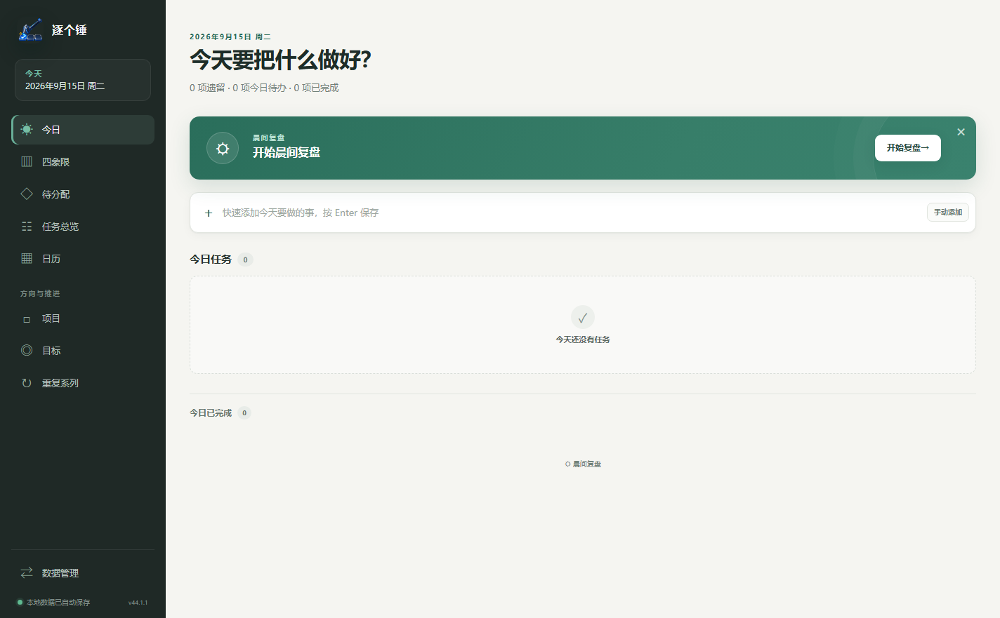

# 逐个锤 · Free Todo

一款面向个人使用的 Windows 本地待办管理应用，用今日清单、项目和目标组织日常行动与长期计划。核心功能无需账号或联网，数据保存在自己的电脑上。

[下载 Windows 安装包](https://github.com/Lili-big/free-todo/releases/latest) · [使用与迁移说明](docs/data-management.md) · [开发指南](docs/development.md) · [问题反馈](https://github.com/Lili-big/free-todo/issues)



## 功能

- **今日清单与晨间复盘**：回顾昨日结果、处理遗留任务、查看待分配事项，确认今天要做的事。
- **按天计划**：任务按自然日安排；没有日期的任务保留在“待分配”，未完成的历史任务保留原计划日。
- **父子任务**：支持一层父子关系，可挂接已有父任务或新建父任务。
- **项目与目标**：用项目组织阶段性成果；目标支持自定义分类、P0–P3 优先级和月度、季度、年度或自定义周期。
- **四象限**：按重要程度和紧急程度整理可执行任务。
- **周/月日历**：查看各自然日的任务安排。
- **重复任务**：支持每日、每周和每月规则，保留历史实例与单次例外。
- **完整备份与恢复**：导出单个 `.todo-backup` 文件，在另一台电脑上校验并恢复任务空间。
- **企业微信日历**：可选的 CalDAV 连接，将外部日程作为只读内容展示；连接后支持自动刷新与离线缓存。
- **托盘与自启动**：关闭窗口后驻留托盘，可在设置中启用开机启动。

## 下载与安装

当前版本：**v1.3.2**。支持 **Windows 10/11 x64**，其他操作系统暂未提供安装包。

1. 打开 [Releases](https://github.com/Lili-big/free-todo/releases/latest)，下载 `ZhuGeChui-Setup-1.3.2-x64.exe`。
2. 运行安装程序，按向导选择安装位置。
3. 启动“逐个锤”，添加任务即可使用。安装包已包含运行时，不需要安装 Node.js。

关闭窗口后应用会留在系统托盘；完全退出请使用托盘菜单中的“彻底退出”。升级前建议先在“数据管理”中导出完整备份，再运行新版安装包覆盖安装。

安装包尚未进行代码签名。可下载同一 Release 中的 `SHA256SUMS.txt`，并在 PowerShell 中检查文件哈希是否一致：

```powershell
Get-FileHash .\ZhuGeChui-Setup-1.3.2-x64.exe -Algorithm SHA256
```

安装包通过 GitHub Releases 分发，源码仓库不包含安装包、依赖目录或个人数据。

## 数据与隐私

任务数据库默认位于 `%LOCALAPPDATA%\personal-todo\data\app.sqlite3`，核心功能不依赖登录、云同步或遥测。企业微信日历仅在用户连接后联网同步。

- 使用“数据管理 → 导出完整备份”迁移数据，避免在应用运行时直接复制数据库文件。
- 恢复备份会**全量覆盖**当前任务空间；应用会先创建并校验安全备份。
- SQLite 数据库和 `.todo-backup` 文件为**明文数据**，请妥善保管备份。
- 企业微信日历凭据由系统安全存储机制加密保存，连接信息和只读日程缓存不包含在任务备份中；换电脑后需重新连接。

完整步骤见 [数据管理与迁移](docs/data-management.md)。

## 从源码运行

开发环境：Windows 10/11 x64、Node.js 24（见 `.node-version`）和 npm。

```powershell
git clone https://github.com/Lili-big/free-todo.git
cd free-todo
npm ci
npm run dev
```

主要命令：

| 命令 | 用途 |
| --- | --- |
| `npm run typecheck` | TypeScript 静态检查 |
| `npm test` | 单元、属性与集成测试 |
| `npm run test:watch` | 持续测试 |
| `npm run build` | 类型检查并构建应用 |
| `npm run test:e2e` | 构建后运行 Playwright Electron E2E |
| `npm run package:dir` | 生成 Windows 解包版 |
| `npm run test:packaged` | 对已有解包版进行启动、SQLite 写入及重启读取检查 |
| `npm run package:win` | 生成 Windows x64 NSIS 安装包 |

打包输出位于 `release/`。构建环境、测试隔离和升级兼容要求见 [开发指南](docs/development.md)。

## 项目结构

```text
src/
├─ main/             # Electron 主进程、业务规则、SQLite、备份与日历集成
├─ preload/          # 受控 IPC 接口
├─ renderer/         # React 界面
└─ shared/           # 公共类型、校验与 IPC 定义
tests/               # 单元、集成和端到端测试
scripts/             # Windows 打包与解包版检查
build/               # 应用图标
docs/                # 使用、开发文档与截图
```

技术栈：Electron、React、TypeScript、Vite、SQLite（better-sqlite3 / Drizzle）、Vitest 与 Playwright。

历史设计资料：[V1.0 需求说明](个人待办管理软件需求说明-V1.0.md)、[V1.0 技术方案](个人待办管理软件技术方案-V1.0.md)。这些资料记录早期设计，当前行为以源码和最新使用文档为准。

## 参与贡献

欢迎通过 [Issues](https://github.com/Lili-big/free-todo/issues) 报告问题或提出改进，也可以提交 Pull Request。请提供应用版本、Windows 版本、复现步骤和预期结果；涉及界面时可以附上去除私人信息的截图。

开发贡献流程见 [CONTRIBUTING.md](CONTRIBUTING.md)。

## 许可证

本项目采用 [MIT License](LICENSE)。第三方依赖及 Electron / Chromium 随附组件遵循各自许可证。
